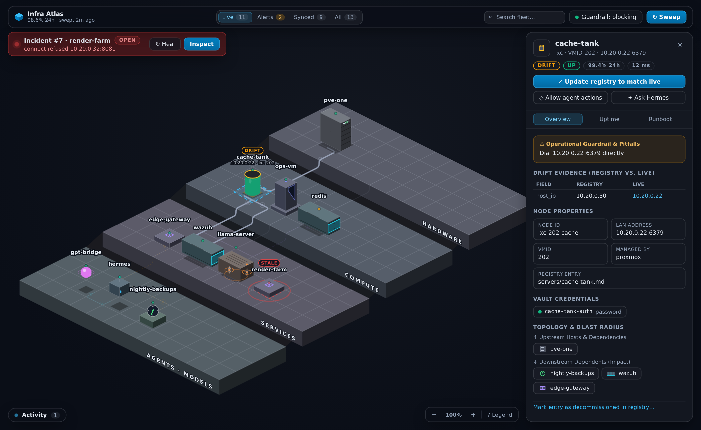

# Infra Atlas

A Hermes Agent plugin that turns a Markdown infrastructure registry into a **live,
self-healing infrastructure graph** — and enforces the rule that an agent reads the
documentation *before* it touches the box.



- **Knowledge layer** — `servers/`, `services/`, `projects/` entries with optional YAML
  frontmatter; legacy prose-only entries are parsed heuristically so nothing has to be
  rewritten by hand.
- **Live layer** — zero-config discovery of this host (systemd user/system units, listening
  ports, Docker/Podman, the Tailscale CLI) and of the Hermes runtime (model endpoints, MCP
  servers, cron jobs and their freshness); opt-in Proxmox VE and Headscale APIs; bounded
  TCP/HTTP probes.
- **Fusion layer** — every node is classified as `matched`, `changed`, `unregistered`,
  `stale` or `doc_only`, with field-level evidence, and one call adopts reality back into
  the Markdown.
- **Read-before-you-touch guardrail** — a `pre_tool_call` policy hook **blocks** a
  `terminal` / `write_file` / `patch` call that touches a documented host, VM, container,
  IP, systemd unit or project path when the session has not read that entry yet, and tells
  the agent exactly which entry to read (including the pitfalls you documented).
- **Uptime + autonomous downtime response** — rolling probe history, flap suppression,
  incidents, and a two-stage heal: a deterministic local restart playbook first, then the
  agent itself, woken with the node's own runbook as the brief. Healthy ticks cost zero
  LLM tokens (`{"wakeAgent": false}`).

## Install

```bash
hermes plugins install <owner>/infra-atlas      # or link a checkout:
ln -s ~/src/infra-atlas ~/.hermes/plugins/infra-atlas
hermes plugins enable infra-atlas
```

Then open **Infra Atlas** in the desktop sidebar (or ⌘K → “Infra Atlas: open the
infrastructure graph”). The desktop half is opt-in: flip it on in Capabilities → Plugins.

## First five minutes

```text
/atlas                     # counts, guardrail mode, open incidents
infra_bootstrap            # add frontmatter to an existing Markdown registry
infra_sweep                # discover + probe + diff
infra_query node_id=…      # read one entry (and unlock it for this session)
```

No registry yet? `infra_bootstrap mode=scaffold_from_live` writes a starter directory from
what the collectors can actually see (this host, the Hermes runtime, and Proxmox or Headscale
when those are configured). To see the whole thing working without touching a real machine,
point `registry_path` at the fictional fleet in [`examples/registry`](examples/registry) and
run `infra_sweep` — six entries, documentation addresses only, one retiring and two failing
on purpose.

## The registry entry

```markdown
---
id: svc-litellm
kind: service
label: LiteLLM Gateway
parent_id: lxc-201
host_ip: 10.0.0.212
ports: [4000]
managed_by: systemd-system
systemd_unit: litellm.service
probe: http://10.0.0.212:4000/health/liveliness
recovery_cmd: "systemctl restart litellm.service"
auto_heal_policy: auto
depends_on: [svc-litellm-postgres]
pitfalls: "Dial 10.0.0.212:4000 directly; the old front was removed."
---

# LiteLLM Gateway
…your runbook, untouched…
```

`infra_upsert` merges frontmatter and never truncates the prose below it; it also updates
`INDEX.md` and prepends a `change-log.md` entry.

`kind` decides which terrace a node lands on, so an entry that sits in `servers/` but is
really a guest is corrected at parse time: **anything with a `vmid` — or a Proxmox guest with
a `parent_id` — is drawn as a VM on COMPUTE, not as metal on HARDWARE.** A hypervisor has no
vmid, so the test is safe both ways, and you never have to file entries in a different folder
to get the picture right.

`pitfalls` is surfaced in the guardrail
block message and in the outage brief, so the operator's hard-won rules reach the agent at
the moment they matter.

## Tools

| Tool | What it does |
|---|---|
| `infra_query` | Read a node (runbook + live diff + uptime + blast radius). Unlocks it for write/terminal use in this session. |
| `infra_sweep` | Run collectors + probes, recompute drift, evaluate incidents, attempt the safe local heal. |
| `infra_diff` | What changed, which incidents opened, who touched what — over a window. |
| `infra_upsert` | Create/update/adopt/remove a registry entry, with change-log. |
| `infra_bootstrap` | Annotate an existing KB, or scaffold one from live discovery. |
| `infra_incidents` | List/get/heal/resolve/escalate incidents; install the zero-token watchdog. |

Bundled skill: `infra-atlas:infra-atlas` (loaded automatically when the plugin is enabled).

## Settings

`registry_path`, `guardrail_mode` (`block`/`warn`/`off`), `auto_heal_mode`
(`auto`/`playbook_only`/`notify_only`/`off`), `failure_threshold`, `heal_cooldown_sec`,
the three zero-config collectors, and the opt-in Proxmox/Headscale
credentials (secrets go to `.env` through Hermes and are read with `agent.secret_scope`).

## What it touches

- **Reads** the registry directory, `$HERMES_HOME/cron/jobs.json`, the Hermes config
  (read-only), `/proc/net/tcp`, and — only when configured — the Proxmox and Headscale
  APIs.
- **Writes** only inside the registry directory (entry files, `INDEX.md`, `change-log.md`)
  and its own SQLite database under `$HERMES_HOME/plugin-data/infra-atlas/`.
- **Runs commands** only for `recovery_cmd`, only on this host, only for an allow-listed
  prefix (`systemctl …`, `service …`, `docker compose …`, `podman …`, `pct …`, `qm …`),
  with a cooldown and an attempt budget.
- **Blocks** mutating tool calls while the guardrail is in `block` mode; set it to `warn` or
  `off` to disable. Inspection is never blocked and never unlocks: `systemctl status|cat|show`,
  `journalctl`, `docker ps|logs|inspect`, `qm list`, `pvesh get`, `ip addr`, a plain `curl`/`wget`
  GET. A `-X POST`/`-d`/`--data` request, or any `systemctl start|stop|restart|reload|enable`,
  still requires the entry to have been read.

No telemetry, no network calls to anything not configured above.

## Layout

```
plugin.yaml          manifest (tools, hooks, settings)
__init__.py          register(ctx)
registry_kb.py       Markdown ↔ node model, atomic writer, change-log
collectors/          local host, Hermes runtime, Proxmox, Headscale, probes
fusion.py            correlation + drift classification + sweep
uptime.py            probes → incidents → playbook/agent response, watchdog script
matcher.py           tool call → nodes (IPs, units, VMIDs, paths)
hooks.py             pre_tool_call guardrail, post_tool_call activity
atlas_tools.py       the six tools
dashboard/           FastAPI routes under /api/plugins/infra-atlas
desktop/plugin.js    full-page graph, inspector, statusbar chip, ::infra / ::drift cards
skills/infra-atlas/  the bundled protocol skill
tests/               pytest suite (registry, fusion, gate, uptime, collectors, API, registration)
```

## Tests

```bash
tools/check.sh                       # every gate: compile, syntax, 8 surfaces, gestures,
                                     # layout, manifest validation, pytest, coverage floor
PYTHONPATH=<hermes-agent checkout> python -m pytest
PYTHONPATH=<hermes-agent checkout> python -m coverage run --source=. --omit='tests/*,tools/*,desktop/*' -m pytest
python -m coverage report      # 82% of statements; tools/check.sh fails under 75%
hermes plugins doctor .
hermes plugins validate .
```

The desktop half has its own check — it is loaded uncompiled by the app, so a bad
component only fails at render time:

```bash
node tools/render_smoke.mjs --modules /path/to/a/node_modules   # needs react + react-dom
```

It renders every registered surface (page, chip, both transcript cards) with
`react-dom/server` against a stubbed `@hermes/plugin-sdk`, fails on any crash,
and asserts that the page actually renders the isometric scene (platforms,
per-kind shapes, routed edges, packets). Eight of eight surfaces render on this
tree.

### The isometric topology

The page draws the fleet as a **terraced isometric diorama** (SVG, `viewBox`
pan/zoom — still selectable, keyboard-reachable and crisp at any zoom):

- One terrace per stratum (hardware → compute → services → agents), cascading
  downhill toward the viewer so dependency edges literally flow down the hill.
  Terrace fronts drop to the base plane and slope risers fuse them into one
  landmass.
- Every node kind is its own 3-D silhouette: server = LED-blinking rack,
  VM = tower with a scanning screen, LXC = tank whose liquid level tracks
  uptime, **container = corrugated cargo crate with doors**, service = pad,
  **inference server = low GPU chassis with two spinning fan discs and a heat
  shimmer**, project = plate, agent = hovering bot, model endpoint = orbiting
  orb, cron = clock with a rotating hand, peer = pyramid with ping rings.
  Health is a colored beacon; drift is a floating chip and an underglow.
- Container and inference silhouettes are **inferred**, not hand-filed: an entry
  managed by docker/podman/compose draws as a crate, and one that names a model
  server (llama-server, llama.cpp, vLLM, Ollama, SGLang, TensorRT-LLM, TGI,
  llama.cpp forks…) draws as a GPU rig — while its control plane (dashboard,
  control, proxy, metrics shim, router) stays a plain service.
- Edges are routed on the tile grid (A\* with footprint obstacles + congestion
  cost): parallel connections fan into side-by-side lanes, terrace steps are
  crossed squarely, and each relation has its own color, dash rhythm and a
  travelling packet dot.
- Micro-animations (entrance drop-in, LEDs, slosh, scanline, bob, orbit, flow),
  phase-shifted per node, suppressed on large fleets (see *Decoration is data*)
  and disabled under `prefers-reduced-motion`. Guardrail pulses keep their
  semantics: blocked
  calls shake the node with red ripples and scatter red packets along its
  edges; reads and allowed touches flash cyan/green.
- **Guests follow their hypervisor.** Within a terrace a node whose parent sits in a lower
  terrace sorts by the parent's position, so the VMs of a host land together in the same part
  of the grid as that host, ahead of unrelated nodes that happen to sort earlier.
- Tailnet peers report `up` when online and `unknown` when not: a laptop with the lid shut is
  not an outage, and eighteen red beacons would drown the fleet's real signal.
- Terraces pack **up to three rows deep** and the depth is chosen per tier: every row
  combination (at most 3⁴) is measured and the one closest to a 1.4:1 footprint wins, with
  the most compact packing breaking ties. A forty-service tier becomes 14×3 instead of a
  40-tile ribbon, so a big fleet reads as a block rather than a letterbox.

The page around it stays deliberately sparse:

- **One floating command bar** — brand + live 24h fleet uptime + sweep age, the view switcher
  (`Live` / `Alerts` / `Synced` / `All`), inline search, a single policy popover (guardrail
  mode, downtime response, background watchdog), and one primary `Sweep` action.
- **A slide-over inspector drawer** that only exists while a node is selected: one contextual
  primary action (`Adopt Live Drift` when it has drifted, `Run Playbook` when it is down), a
  symmetric secondary row (`Unlock Chat`, `Ask Hermes`), and three tabs — `Overview`
  (pitfalls callout, field-by-field diff, properties, clickable blast radius), `Uptime`
  (24h %, latency sparkline, probe target, incident history with inline resolve), `Runbook`.
- **Direct manipulation**: drag to pan (content follows the cursor), scroll or pinch to zoom
  around the pointer, double-click to zoom in (shift double-click out), and the `− 100% +`
  cluster resets or steps. Gestures are handled imperatively — the viewBox is written in a
  rAF and React state only syncs when the gesture ends — so a hundred-node fleet pans at
  frame rate instead of re-rendering the whole tree per pointermove.
- **Decoration is data.** Past ~44 nodes the canvas goes lean: perpetual LED/scan/packet
  animation is kept only for the selected node, nodes with incidents and their edges, and
  everything else holds still (and `prefers-reduced-motion` wins everywhere).
- **Two corner docks**: a collapsible live-activity feed (reads / touches / blocked calls) and
  a combined zoom + legend control. `Esc` or a click on empty canvas closes the drawer and
  gives the whole viewport back to the map.
- **Retired entries stay off the map.** An entry with `status: removed` is history, not
  infrastructure: it is not drawn as an empty shape, not probed, and not counted in the
  `All` badge (the legend says how many are hidden). Opening one anyway — a stale selection,
  a `::infra{}` link — explains that it is retired and offers **Restore to active**, instead
  of showing a panel full of empty fields.

To see it live without the desktop app:

```bash
node tools/iso_preview.mjs            # then open the printed URL
# ?fleet=stub | live | single | flat — the control bar can fire guardrail pulses so you
# can watch the shake/ripple animations.
```

MIT.
